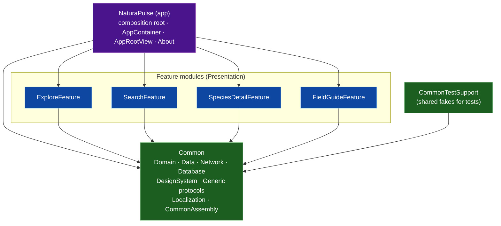

# Modularization — NaturaPulse

NaturaPulse is split into **Swift Package Manager packages**. The shared base module (`Common`) is published as a separate package and consumed **remotely** over SPM (`https://github.com/rfbnr/NaturaPulse-Common.git`, `from: "1.0.0"`); it provides all of Domain, Data, core infrastructure, the design system, generic protocols, and localization. Each feature is a **local package** (under `Modules/`) that holds only the Presentation layer and depends on the remote `Common`. The main app (`NaturaPulse`) is the composition root that assembles everything.

## Module relationships



**Dependency rule (star graph):** every feature module depends **only** on `Common`. There are no feature-to-feature dependencies. The app depends on `Common` plus the four feature modules, and is the single place where concrete implementations are assembled.

## Modules

| Module | Type | Responsibility | Depends on |
|---|---|---|---|
| **Common** | Library (SPM) — *published, consumed remotely* | Entities, AppError, repository protocols, all use cases, all Data (GBIF/Open-Meteo/Realm: DTOs, data sources, mappers, repository impls), Network (APIClient), Database (RealmProvider), DesignSystem (Colors/Typography/Spacing/Components/Motion), `LoadState`, `AppRoute`, generic protocols, localization, `CommonAssembly` | Alamofire, Swinject, RealmSwift, Kingfisher |
| **ExploreFeature** | Library (SPM) | `ExplorePresenter` + `ExploreView` (+ components) + `ExploreAssembly` | Common, Swinject |
| **SearchFeature** | Library (SPM) | `SearchPresenter` + `SearchView` + `SearchAssembly` | Common, Swinject |
| **SpeciesDetailFeature** | Library (SPM) | `SpeciesDetailPresenter` + `SpeciesDetailView` + factory + `SpeciesDetailViewProvider` + `SpeciesDetailAssembly` | Common, Swinject |
| **FieldGuideFeature** | Library (SPM) | `FieldGuidePresenter` + `FieldGuideView` + `FieldGuideAssembly` | Common, Swinject |
| **CommonTestSupport** | Library (SPM) | Shared fake repositories + `Species.stub` for test targets | Common |
| **NaturaPulse** | App | Composition root (`AppContainer`), `AppRootView` (TabView), `AboutView`, `NaturaPulseApp` | Common + 4 feature modules |

## Generic protocol approach

`Common/Generic/` defines `associatedtype`-based generic contracts (`Common/Sources/Common/Generic/GenericProtocols.swift`):

```swift
public protocol UseCase {
    associatedtype Request
    associatedtype Response
    func execute(_ request: Request) -> AnyPublisher<Response, AppError>
}

public protocol Repository {
    associatedtype Request
    associatedtype Response
    func fetch(_ request: Request) -> AnyPublisher<Response, AppError>
}

public protocol RemoteSource { associatedtype Request; associatedtype Response; func execute(_ request: Request) -> AnyPublisher<Response, AppError> }

public protocol Mapper {
    associatedtype DTO
    associatedtype Domain
    func toDomain(_ dto: DTO) -> Domain
}

public struct Interactor<Request, Response, R: Repository>: UseCase
where R.Request == Request, R.Response == Response {
    public init(repository: R)
    public func execute(_ request: Request) -> AnyPublisher<Response, AppError>
}
```

A real vertical that proves the generic pattern end to end is in `Generic/NearbySpeciesGenericVertical.swift`: `NearbySpeciesRepository: Repository` plus `Mapper` (GBIF DTO → `[Species]`) are bridged by `Interactor` into a `UseCase` — exercised in the test target.

## Cross-module dependency inversion

To keep feature modules from depending on each other, navigation to the Detail screen uses an **abstraction in Common**, not a concrete type from `SpeciesDetailFeature`:

```swift
// Common
public protocol SpeciesDetailViewProviding {
    @MainActor func makeDetailView(for species: Species) -> AnyView
}
```

`SpeciesDetailFeature` provides the concrete implementation (`SpeciesDetailViewProvider`), registered in `SpeciesDetailAssembly`. The Explore/Search/FieldGuide list views `resolve(SpeciesDetailViewProviding.self)` from the container — so they only need `import Common`. The concrete implementation is assembled at the composition root (app). This is what keeps the graph star-shaped.

## Cross-module dependency injection

Swinject is the composition root. `CommonAssembly` (in `Common`) registers all shared infrastructure — `APIClient`, `RealmProvider`, every data source, repository, and use case. Each feature `*Assembly` registers only its presenter/provider. `AppContainer` assembles them all:

```swift
Assembler([
    CommonAssembly(),
    AppAssembly(),
    ExploreAssembly(),
    SearchAssembly(),
    SpeciesDetailAssembly(),
    FieldGuideAssembly()
])
```

## Localization

The `Common` module holds the localized strings (`Common/Resources/{en,id}.lproj/Localizable.strings`) and the helper `public extension String { var localized: String { NSLocalizedString(self, bundle: .module, comment: "") } }`, which reads from `Bundle.module`. Because the strings live in the module, every feature uses the same keys without duplication.

## Testing each module

Each package has its own test target. Shared fake repositories live in the `CommonTestSupport` product so feature test targets can reuse them.

```bash
# Each feature (run from its own directory)
cd Modules/ExploreFeature && xcodebuild test -scheme ExploreFeature -destination 'platform=iOS Simulator,name=iPhone 17 Pro'
# App (assembles every module)
xcodebuild test -scheme NaturaPulse -destination 'platform=iOS Simulator,name=iPhone 17 Pro'
```

`Common` is published as a separate package and consumed remotely over SPM (`https://github.com/rfbnr/NaturaPulse-Common.git`, `from: "1.0.0"`); the `Common` and `CommonTestSupport` tests run in that repository.
