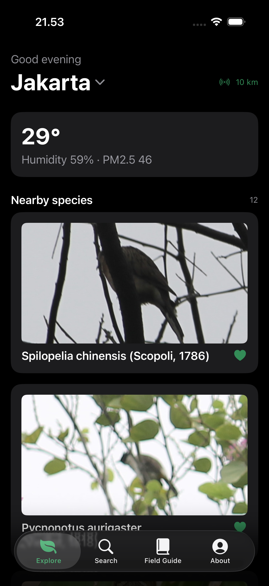
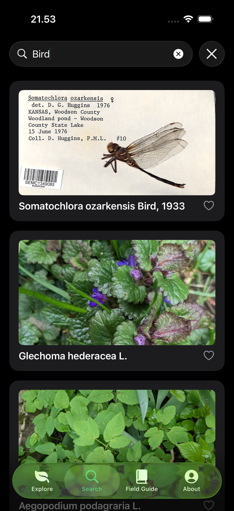
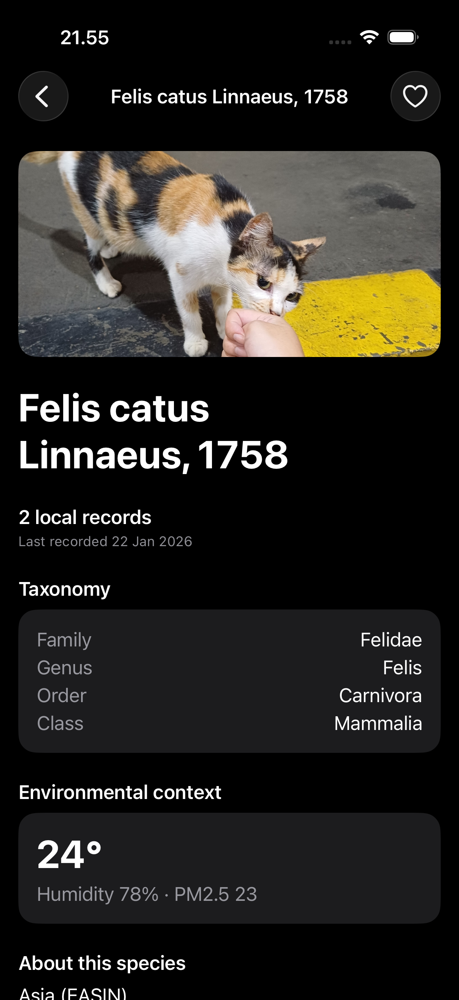
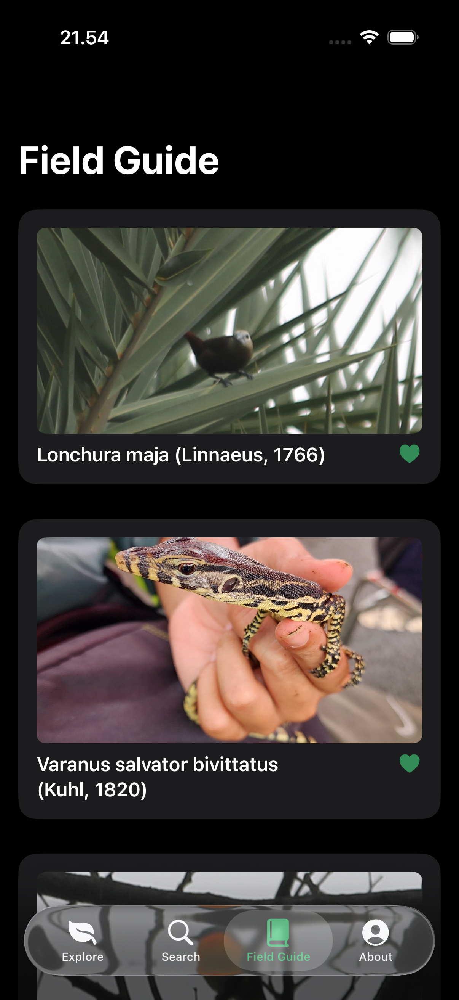
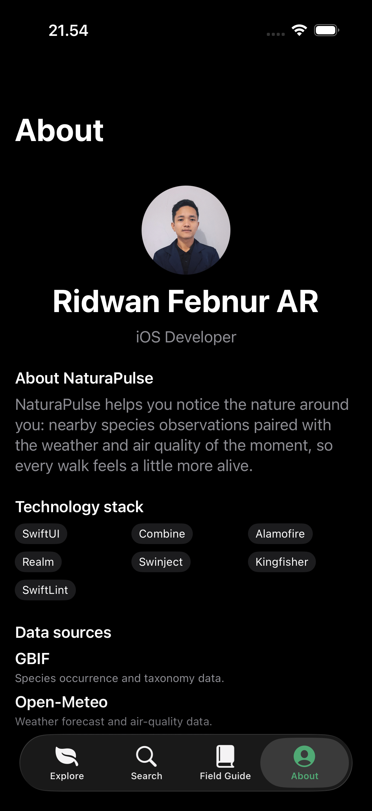
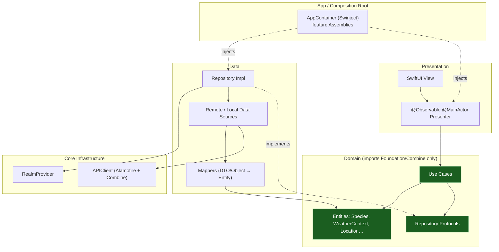
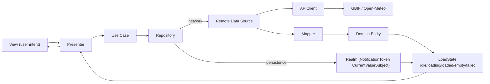

# NaturaPulse

[Bahasa Indonesia](README.id.md)

[](https://github.com/rfbnr/NaturaPulse/actions/workflows/ci.yml)


[](LICENSE)

A location-aware iOS app that answers one question: **which species have been recorded near this place?** It pairs biodiversity occurrence data (GBIF) with light environmental context (Open-Meteo).

> Built as the final project for Dicoding's "Menjadi iOS Developer Expert" (Become an Expert iOS Developer) course.

You explore species recorded near a location, search the catalog by name, open a species detail with local records, save species to a personal Field Guide, and browse that collection offline. Weather and air-quality data are shown **as context only** — not as a causal claim about species behavior.

- **Platform:** iOS 26.5 · SwiftUI · Combine
- **Architecture:** Feature-First Clean Architecture (Presentation / Domain / Data), **modularized** as Swift Packages (a published Common module plus one local module per feature) with a Swinject composition root
- **Data:** GBIF (biodiversity) · Open-Meteo (weather, air quality, geocoding)
- **Persistence:** Realm · **Images:** Kingfisher · **Networking:** Alamofire · **Lint:** SwiftLint

---

## Highlights

- **Modular Swift Packages.** The shared `Common` module is published as a standalone SPM package and consumed **remotely**; each feature is a local package. The dependency graph is a star — every feature depends only on `Common`, with no feature-to-feature coupling.
- **Feature-First Clean Architecture.** Domain depends on nothing but Foundation/Combine; Data implements Domain contracts; Presentation consumes use cases; a single Swinject composition root assembles the concrete types.
- **Reactive data flow with Combine.** Search is debounced, deduplicated, and cancelable (latest query wins); Realm changes are bridged to Combine and drive the UI.
- **Offline-capable Field Guide** backed by Realm, fully browsable without a network connection.
- **Generic, protocol-oriented domain layer** — `UseCase` / `Repository` / `Mapper` plus a generic `Interactor` wired end to end.
- **112 XCTest methods** across the modules, and CI on GitHub Actions (build + test + coverage, SwiftLint, dependency vulnerability scan).

---

## Screenshots

| Explore                            | Search                           | Detail                           | Field Guide                                | About                          |
| ---------------------------------- | -------------------------------- | -------------------------------- | ------------------------------------------ | ------------------------------ |
|  |  |  |  |  |

---

## Features

- **Explore** — nearby species for the current or a chosen location, with an environmental snapshot (temperature, humidity, PM2.5). Radius control, pull-to-refresh, stale-while-loading, and clean empty/error states.
- **Search** — reactive species search: trim → minimum length → **debounce (300 ms)** → **deduplicate** → **cancel stale requests** (the latest query wins).
- **Species Detail** — hero image, taxonomy, a summary of local records, neutral environmental context, on-demand species descriptions (GBIF), source/image attribution, and a favorite button.
- **Field Guide** — species saved in Realm, browsable **offline**, reactive to changes, with swipe-to-delete.
- **About** — developer profile, mission, tech stack, and data attribution.
- **Polish** — shimmer skeletons, subtle motion, haptics, and an accessibility pass (Dynamic Type, VoiceOver, Reduced Motion, status cues that do not rely on color alone).

Favoriting works from the Explore/Search cards, the Field Guide, and the Detail screen — you do not need to open Detail to save a species.

---

## Architecture

Feature-First Clean Architecture: each feature has its own `Presentation`, `Domain`, and `Data` layers. Dependencies point inward — **Domain depends on nothing** (Foundation/Combine only), Data implements Domain contracts, Presentation consumes Domain use cases, and the app's composition root is the only place where concrete types are wired together.



**Enforced rules:** Domain does not import SwiftUI/UIKit/Alamofire/Realm/Swinject/Kingfisher. No DTO or Realm object leaks into Presentation — data is mapped to value-type entities at the Data boundary. Features do not reach into each other's repositories or data sources; shared needs live in `Common`. Concurrency: the app target uses `nonisolated` default actor isolation — Domain/Data are thread-agnostic, and Presenters are explicitly `@MainActor`.

### Data flow (Combine)



The Search pipeline uses `debounce → removeDuplicates → switchToLatest` with an inner `.catch` so the stream survives errors, plus a separate retry subject so a retry re-runs the current query. Field Guide observation bridges Realm's `NotificationToken` to a `CurrentValueSubject` (`collectionPublisher` on the Realm build in use does not deliver notifications reliably).

---

## Tech Stack

| Need                | Choice                                              | Version  |
| ------------------- | --------------------------------------------------- | -------- |
| UI                  | SwiftUI                                             | iOS 26.5 |
| Reactive            | Combine                                             | —        |
| Networking          | [Alamofire](https://github.com/Alamofire/Alamofire) | 5.12.0   |
| Dependency Injection| [Swinject](https://github.com/Swinject/Swinject)    | 2.10.0   |
| Local database      | [RealmSwift](https://github.com/realm/realm-swift)  | 20.0.5   |
| Image loading/cache | [Kingfisher](https://github.com/onevcat/Kingfisher) | 8.12.0   |
| Linting             | [SwiftLint](https://github.com/realm/SwiftLint)     | dev tool |
| Testing             | XCTest                                              | —        |

Built with Xcode 26 (Swift 5 language mode; package manifests use Swift tools 6.3). Dependencies are managed with Swift Package Manager and resolved automatically by Xcode.

---

## Data Sources & Attribution

**GBIF — Global Biodiversity Information Facility** (primary data)

- Nearby species: `GET /v1/occurrence/search?geoDistance={lat},{lon},{r}km&mediaType=StillImage&limit=20`
- Search by name: `GET /v1/occurrence/search?q={query}`
- Species descriptions: `GET /v1/species/{speciesKey}/descriptions`
- Occurrence media may be licensed differently from the occurrence data, so creator/license/source metadata is preserved and shown on the Detail screen.

**Open-Meteo** (environmental context — context only, not a biodiversity signal)

- Forecast, air-quality (PM2.5), and geocoding APIs. The data is licensed **CC BY 4.0** and requires attribution.

The public GBIF and Open-Meteo endpoints used here do not require an API key.

---

## Project Structure

Feature modules are **Swift Package Manager local packages** under `Modules/`, with the app as a thin composition root. The shared `Common` module is a **separate published package**, consumed remotely over SPM.

```text
NaturaPulse/
├── Modules/                     # Local Swift packages (feature modules only)
│   ├── ExploreFeature/          # Presentation + Assembly (imports Common)
│   ├── SearchFeature/
│   ├── SpeciesDetailFeature/
│   └── FieldGuideFeature/
├── NaturaPulse/                 # App target (thin)
│   ├── App/                     # NaturaPulseApp, AppRootView, AppContainer (composition root)
│   └── Features/About/          # About screen
├── MODULARIZATION.md
└── NaturaPulse.xcodeproj

# Common — Domain, Data, Network, Database, DesignSystem, generic protocols,
# localization (en/id), CommonAssembly, and the CommonTestSupport product —
# is published separately and consumed via SPM:
#   https://github.com/rfbnr/NaturaPulse-Common
```

Each feature module depends only on `Common` (no feature-to-feature dependencies). Module architecture, the generic protocols, and the relationship diagram are in **[MODULARIZATION.md](MODULARIZATION.md)**.

---

## Modularization

- **`Common`** — the shared base module: all Domain (entities, repository protocols, use cases), Data (GBIF/Open-Meteo/Realm), Core (APIClient/RealmProvider), DesignSystem, **generic protocols** (`UseCase`/`Repository`/`Mapper`/`Interactor`), **localization** (`Localizable.strings` en/id via `Bundle.module`), and `CommonAssembly` (Swinject).
- **Feature modules** (`ExploreFeature`/`SearchFeature`/`SpeciesDetailFeature`/`FieldGuideFeature`) — Presentation layer and assembly only; navigation to Detail goes through the `SpeciesDetailViewProviding` abstraction in `Common` (dependency inversion, no feature-to-feature dependencies).
- **Published module (SPM):** `Common` is published as a standalone package — **https://github.com/rfbnr/NaturaPulse-Common** (tags `1.0.0` and `1.0.1`). The app and every feature module consume it remotely via `.package(url: "…/NaturaPulse-Common.git", from: "1.0.0")`.

---

## Getting Started

1. **Requirements:** Xcode 26+ (iOS 26.5 SDK), macOS with an iOS 26.5 simulator or a device.
2. Clone the repository and open `NaturaPulse.xcodeproj`.
3. Xcode resolves the local feature packages and the remote `Common` package, along with their transitive dependencies (Alamofire, Swinject, RealmSwift, Kingfisher), automatically. Wait for "Package resolution" to finish.
4. Select the **NaturaPulse** scheme and an iOS 26.5 simulator (or your device), then **Run** (`⌘R`).

Location permission is optional — if denied, the app falls back to a default location (Jakarta) and manual location lookup via Open-Meteo geocoding.

---

## Testing

Each module has its own test target. Run them through their schemes:

```bash
# App (assembles every module)
xcodebuild test -scheme NaturaPulse -destination 'platform=iOS Simulator,name=iPhone 17 Pro'

# Each feature module, from its own directory (e.g. Modules/ExploreFeature/)
xcodebuild test -scheme ExploreFeature -destination 'platform=iOS Simulator,name=iPhone 17 Pro'
```

- **112 XCTest methods total** — 40 across the four feature modules in this repo (Explore 10, Search 12, Species Detail 8, Field Guide 10) and 72 in the published `Common` module. They cover Domain use cases, Data mappers/repositories/data sources, Presenters, and DI assemblies.
- Networking is tested with `URLProtocol` stubs (no live calls); persistence uses an in-memory Realm. Shared fakes live in the `CommonTestSupport` product.
- The Domain layer is fully testable without UI or networking.
- `Common` is consumed remotely over SPM (`https://github.com/rfbnr/NaturaPulse-Common.git`); its tests live in that repository.

---

## SwiftLint

SwiftLint (installed via Homebrew) enforces code style; the configuration is in `.swiftlint.yml`.

```bash
swiftlint lint --quiet
```

The project is clean at the error level.

---

## Known Limitations

- **Realm `collectionPublisher`** does not deliver notifications reliably on the Realm build in use, so Field Guide observation uses a `NotificationToken → CurrentValueSubject` bridge.
- **Cleartext images:** some GBIF media URLs are served over `http`; the mapper upgrades them to `https` on a best-effort basis. Hosts that serve `http` only fall back to a placeholder illustration (App Transport Security blocks cleartext).
- **Offline-aware, not offline-first:** the Field Guide is fully browsable offline, but Explore and Search require a network connection.
- **Benign DNS log on first run:** iOS may log a harmless `nw_resolver … did not receive all answers in time` on the first GBIF request while DNS resolves; the request still succeeds and the log does not repeat.
- Pagination is intentionally limited (small page size) rather than infinite scroll.

---

## License

Released under the **MIT License** — see [LICENSE](LICENSE).

Biodiversity data © GBIF contributors; environmental data © Open-Meteo (CC BY 4.0).

---

_Built by Ridwan Febnur AR as the final project of Dicoding's iOS Developer Expert course._
